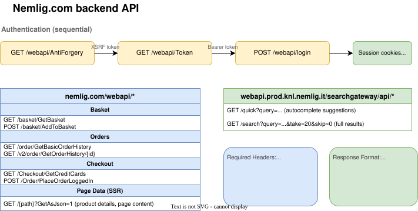
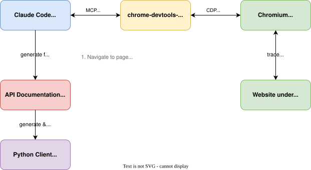

# Nemlig.com CLI

Command-line interface for [nemlig.com](https://www.nemlig.com) Danish online grocery store. Single-file Python implementation using `requests` for HTTP and `argparse` for CLI parsing.

## Features

- Product search and details
- Shopping basket management (view, add and remove items)
- Order history viewing

## Requirements

- Python >= 3.11
- [uv](https://github.com/astral-sh/uv) or Python's built-in venv and pip
- Credentials for nemlig.com account

```bash
# Only the username belongs in environment variables
export NEMLIG_USER="user@example.com"
```

### Optional features

Search, basket and order history use `requests` and `argcomplete`. The remaining
features pull in heavier dependencies and are installed as extras:

| Extra | Enables | Commands |
|-------|---------|----------|
| `ai` | AI meal planning | `plan` |
| `sheets` | Google Forms/Sheets recipe import | `import` |
| `scanner` | Barcode and produce scanning | `scan`, `fridge` |
| `all` | Everything above | |

```bash
uv sync --extra all          # or: --extra ai --extra scanner
```

## Usage

All commands are available via the justfile:

```bash
just search "cocio"              # Search products
just details 701025              # Product details
just basket                      # View basket
just add 701025 2                # Set product quantity (quantity optional, default 1)
just add 701025 0                # Remove product from basket
just history                     # Order history
just history 12345678            # Order details
```

Direct execution:

```bash
uv run python nemlig_cli.py -u "$NEMLIG_USER" search "milk"
```

The password is requested through a hidden terminal prompt. Use the interactive
mode (`python nemlig_cli.py -u user@example.com`) to reuse the login in memory
for several commands. Exiting discards the local session; no password or session
file is written. This does not revoke the session at the server.

### Windows 11 (PowerShell)

From the checkout, with Python 3.11 or newer installed:

```powershell
py -3.12 -m venv .venv
.\.venv\Scripts\python.exe -m pip install "requests>=2.31.0" "argcomplete>=3.0.0"
.\.venv\Scripts\python.exe nemlig_cli.py --help
.\.venv\Scripts\python.exe nemlig_cli.py -u user@example.com
```

Choose your installed Python version in the first command. No activation script,
Bash, `just`, or Windows readline package is required. Tab completion is enabled
only when `readline` is available. Unsupported display characters are replaced
instead of crashing a legacy Windows terminal. AI, Sheets, and camera features
are optional and are not needed for shopping lists.

### Local security change — development toward 0.2.0

This branch is a local development build, not a published release. `--version`
reads the canonical project version and appends the checkout's short Git SHA.

**Incompatible login change:** `-p` / `--password` and passwords in `login.json`
are no longer accepted. `NEMLIG_PASS` is not used. Remove legacy password fields
and password environment settings yourself; the CLI does not migrate or delete
them. A username-only config remains supported. Password entry requires an
interactive terminal and fails if hidden input is unavailable.

The `just` helpers pass values as shell arguments rather than inserting them
into shell source. Login rejection and HTTP errors do not print server bodies.
This change does not harden the optional AI/Google integrations or protect
against software that can already read the process's memory. AI features send
their prompts and tool results to Anthropic; Google tokens retain the upstream
storage behavior.

Run the focused regression tests with `python -m unittest discover -s tests -v`.

## Architecture

**Single file design**: All logic in `nemlig_cli.py` - a straightforward requests-based client.



**Authentication**: 3-step flow (XSRF token -> Bearer token -> Login). Returns `AuthTokens` dataclass passed to all API functions.

**Dual API endpoints**: Main site API (`nemlig.com/webapi/*`) for auth and basket operations; separate search gateway (`webapi.prod.knl.nemlig.it`) for product search.

See `nemlig_api.md` for complete API documentation including request/response schemas.

---

## Development Workflow: API Discovery with Chrome DevTools MCP

This project was built by having Claude Code control a real browser to observe and document the nemlig.com API. The technique generalizes to any web application where you need to reverse-engineer an undocumented API.

### Overview

The workflow enables an AI assistant to control a real browser, observe network traffic, and document API behavior - then implement a client based on the documented findings.



### Self-Contained MCP Setup

The Chrome DevTools MCP integration is fully self-contained:

- `.mcp.json` - MCP server configuration pointing to the wrapper script
- `chrome-devtools-mcp-wrapper.sh` - Nix-shell wrapper ensuring reproducible environment with:
  - Pinned nixpkgs (nixos-25.05) for reproducibility
  - Node.js 22 and Chromium from nix
  - Project-local Chrome profile (`.chrome-profile/`) to avoid tainting global settings
  - Pinned `chrome-devtools-mcp` version (0.10.1)

No global installation required - the wrapper script handles everything.

### API Discovery Process

**Phase 1: Network Traffic Capture**

Human operator directs Claude to:

1. **Open target page** with network recording enabled
2. **Perform the operation** being documented (login, search, add to cart, etc.)
3. **List network requests** to see all HTTP traffic
4. **Get request details** for interesting endpoints (headers, body, response)

Example session:
```
Human: Open nemlig.com and enable network recording. Then login with test credentials and show me the network traffic.

Claude: [Uses Chrome DevTools MCP to navigate, perform login, capture traffic]
        [Lists network requests, identifies auth flow]
        [Documents the 3-step auth: AntiForgery -> Token -> login]
```

**Phase 2: Documentation**

Claude analyzes captured traffic and documents:
- Request URLs, methods, headers
- Request/response body structure
- Authentication requirements
- Parameter meanings

This builds up `nemlig_api.md` incrementally.

**Phase 3: Implementation**

Based on the documented API:
1. Claude implements Python functions matching documented endpoints
2. Human tests implementation against real site
3. Debug issues using Chrome DevTools MCP as grounding (compare browser vs client behavior)

### Context Management

**Important**: MCP tool calls return large responses (>25KB for page snapshots/network dumps). To manage context window size:

- Run all MCP interactions from a **sub-agent** (Task tool with explore or general-purpose agent)
- Sub-agent summarizes findings and returns only relevant info
- Main conversation stays focused on implementation

Example pattern:
```
Human: Document the basket API

Claude: [Spawns sub-agent to handle MCP interactions]

Sub-agent: [Opens page, enables recording, adds item to basket]
           [Captures AddToBasket request/response]
           [Returns summary: endpoint, headers, body format, response structure]

Claude: [Updates nemlig_api.md with documented endpoint]
```

### Debugging with Browser Grounding

When the Python client behaves differently than expected:

1. Perform same operation in browser via MCP
2. Compare exact request headers/body
3. Identify missing headers, wrong parameter format, etc.
4. Fix client implementation

This provides a reliable reference for expected API behavior.

### File Structure

```
nemlig-cli/
├── .mcp.json                       # MCP server configuration
├── chrome-devtools-mcp-wrapper.sh  # Nix-shell wrapper for MCP server
├── .chrome-profile/                # Local browser profile (gitignored)
├── arch_api.drawio.svg             # API architecture diagram
├── mcp-workflow.drawio.svg         # MCP workflow diagram
├── nemlig_api.md                   # API documentation (built via workflow)
├── nemlig_cli.py                   # Python client implementation
├── justfile                        # Command shortcuts
├── pyproject.toml                  # Python project config
└── CLAUDE.md                       # AI assistant instructions
```

## License

MIT
